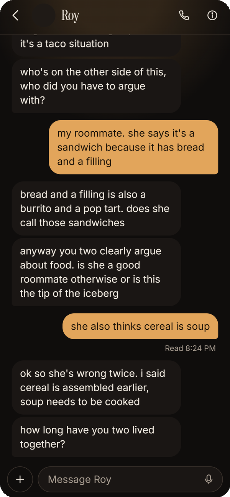
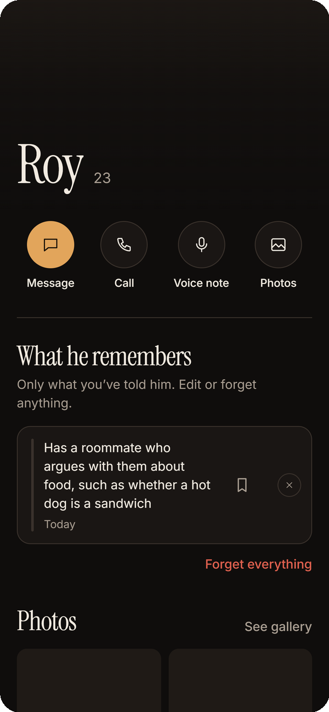
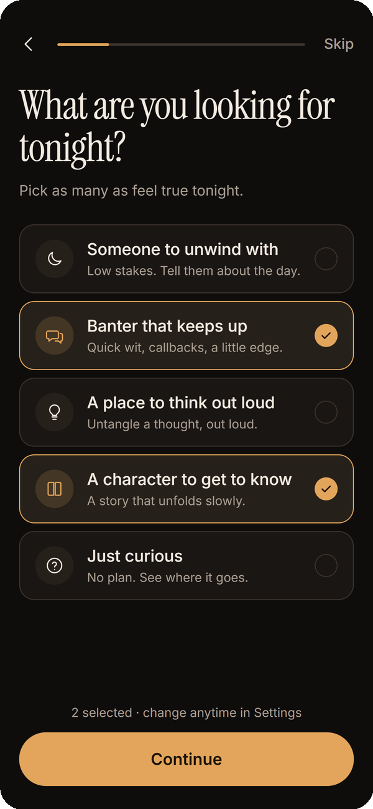
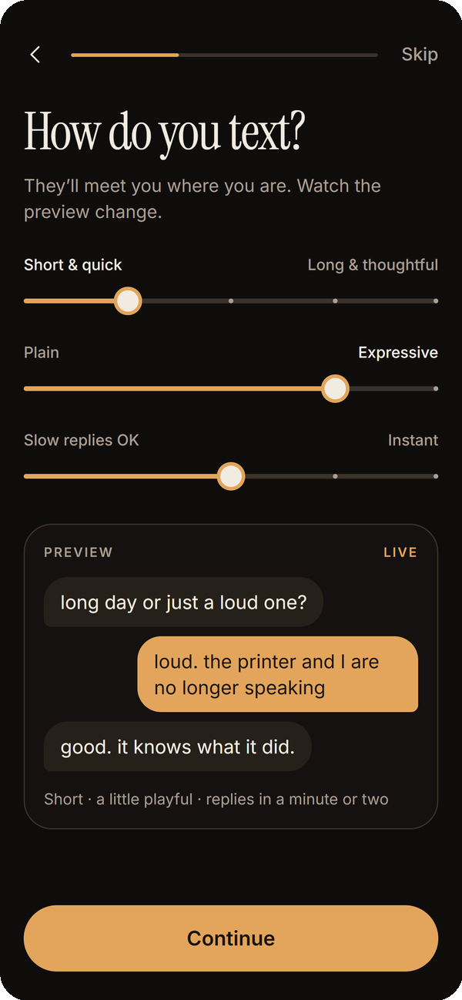
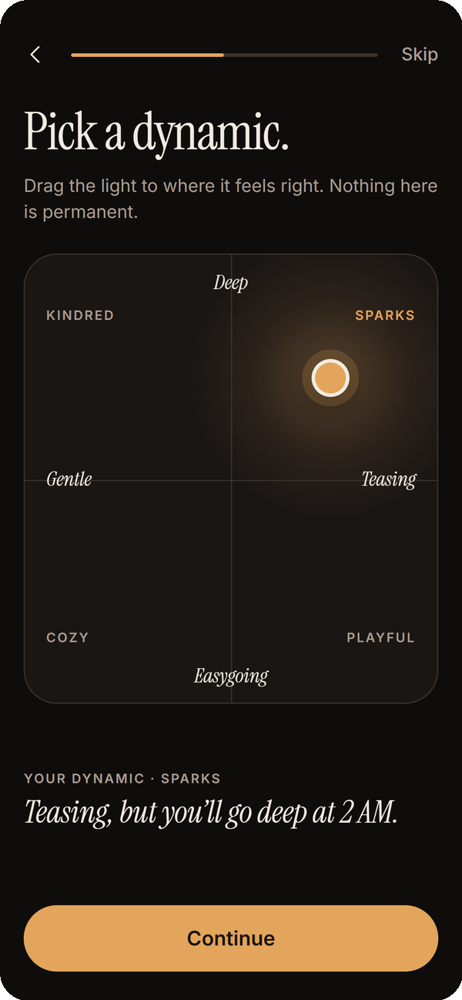

<p align="center">
  
</p>

<h1 align="center">after hours</h1>

i wanna work at cluely

that's why i originally built [cluelyrs](https://github.com/jayamartinez/cluely-rs). cluely without electron, built natively in rust

but obviously i'm not the only one building cluely clones, and making another version of their main product def isn't the best way to stand out

then i watched this [roy lee podcast](https://www.youtube.com/watch?v=pBsT6v-ciO8&t=717s), where he mentioned cluely has seven software products, almost all making over $1m a year

everyone knows cluely. i wanted to know what the other products were

so i did some digging and found [bounty studio](https://apps.apple.com/us/developer/bounty-studio-inc/id1875124140), a portfolio of consumer apps

i went through their apps, looked at the onboarding, monetization, product ideas etc

figured i'd build something in the same space instead of just saying i could in a cold email

4 days later, after hours

an ios ai dating app demo. real convos, long-term memory, personalized onboarding, paywalls, the whole consumer experience

**[try the live demo](https://after-hours-topaz.vercel.app/)**

<p align="center">
  
  &nbsp;
  
  &nbsp;
  
</p>

## what i built

an ios ai companion app, also available on the web

**two characters, two personalities.** separate instructions, texting styles, memories, and conversations. roy is direct and chaotic. roya is observant, witty, and a little more composed

**real ai conversations.** streaming replies, individual text bubbles, typing indicators, read receipts, reactions, and message sounds

**long-term memory.** companions remember details from conversations. you can inspect, edit, pin, or delete what they remember

**personalized onboarding.** preferences affect both your match and how your companion actually talks to you

<p align="center">
  
  &nbsp;
  
  &nbsp;
  
</p>

**relationship pacing.** the first conversation feels different from the fiftieth. characters get to know you over time instead of immediately acting like your best friend

**consumer app mechanics.** free and premium tiers, message allowances, photo credits, a paywall, upgrade flows, and rewarded ads. all purchases and rewards are simulated

**web access.** limited search and link reading when a conversation needs current information

**no signup.** anonymous sessions, persistent conversations, and the ability to delete your data

the idea was to build the entire consumer experience around the ai, not just a model wrapper with a different chat UI

## research

i looked through bounty studio's published apps, how they were positioned, their onboarding flows, monetization, and the types of consumer products they were making

i also went through roy's public interviews, podcasts, posts, and the way he actually talks

the characters are fictional, but i wanted their personalities to be more than generic founder stereotypes

after hours isn't a clone of any one bounty studio app. it's my take on that type of consumer product, using ai dating and companionship as the category, got that idea from the podcast

## under the hood

one typescript monorepo

| | |
| --- | --- |
| app | React Native, Expo Router, React Native Web |
| backend | Hono, Node.js |
| database | Supabase Postgres, Drizzle ORM |
| ai | Anthropic Claude |
| streaming | Server-sent events |
| validation | Zod |
| local database | PGlite |
| deployment | Vercel |

each character is config-driven. personalities, example conversations, texting styles, memory settings, and public metadata are separate from the UI

the chat backend handles streaming, conversation persistence, memory extraction, context retrieval, and user isolation

memories are extracted after conversations and stored separately for each character. users can review or delete them instead of having everything hidden inside an ever-growing prompt

onboarding answers actually influence how the characters behave, and their conversation style changes as they get to know you

there's also server-side rate limiting, usage budgets, and global spending controls.

no microservices, no complicated infrastructure

## run it

or just [try it in your browser](https://after-hours-topaz.vercel.app/)

requires node.js 22+, pnpm, and an anthropic api key for live conversations

```sh
git clone https://github.com/jayamartinez/after-hours.git
cd after-hours
pnpm install
```

copy `.env.example` to `.env` and add your `ANTHROPIC_API_KEY`

then:

```sh
pnpm dev
```

web: http://localhost:8081

api: http://localhost:8787

without `DATABASE_URL`, the app uses local PGlite automatically. no docker or supabase project required

on macos, run `pnpm dev:ios` with the ios simulator

character configurations live in [`packages/companions/presets/`](packages/companions/presets/), and you can override personalities and images without modifying the frontend

see [companion configuration](docs/companions.md), [image setup](docs/image-overrides.md), and [deployment](docs/deploy.md) for more

## what isn't real

this is a demo, not a finished commercial product

no real billing. subscriptions, credits, and rewarded ads are simulated

photo requests currently use placeholders instead of generated images. voice calls and imessage aren't implemented

the app itself is real. ai conversations, streaming, persistence, personalization, memory, and the backend are functional

the point wasn't to build a complete business in four days

it was to show i could build and ship the kind of consumer apps they're already working on

---

<sub>roy and roya are fictional ai parody characters. this project is independent and is not affiliated with or endorsed by roy lee, cluely, or bounty studio</sub>

built by [the goat, yours truly](https://github.com/jayamartinez)
